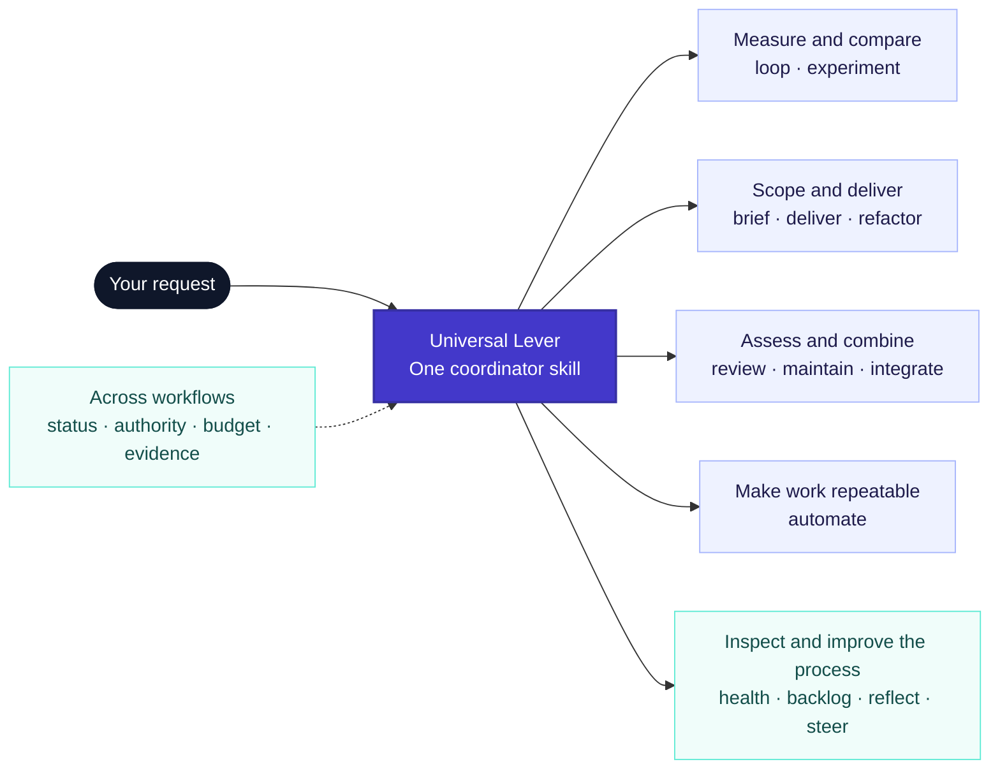
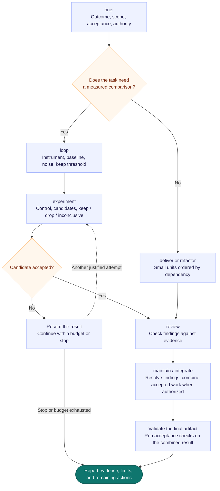

# Universal Lever

**Evidence-driven workflows for local Codex.**

Universal Lever is a Codex plugin that provides instruction-only workflows for turning requests into bounded, testable work. It helps establish measurement loops, compare candidate changes, coordinate implementation and review, and validate results in a local workspace. The plugin has one coordinator skill, `universal-lever`, which routes to the workflow that fits the task. Its instructions do not prescribe fixed models and add no MCP servers or hooks.

This is an independent project with a universal direction, adapted from ideas in GitHub's `lever` project.

## Install

The plugin is packaged at [`plugins/universal-lever/`](plugins/universal-lever/), with its skill at [`plugins/universal-lever/skills/universal-lever/`](plugins/universal-lever/skills/universal-lever/). The recommended installation source is [Pablo's Plugins](https://github.com/pablopoo/codex-marketplace), the central catalog for Universal Lever and GStack Power Team. Each plugin stays in its own repository; the catalog selects reviewed commits.

### Codex CLI — recommended central catalog

With a Codex CLI that supports `plugin marketplace add` and `plugin add` (verified with version 0.163.0), add the marketplace and then install the plugin:

```sh
codex plugin marketplace add pablopoo/codex-marketplace
codex plugin add universal-lever@pablopoo-plugins
```

You can use the full Git URL for the marketplace instead:

```sh
codex plugin marketplace add https://github.com/pablopoo/codex-marketplace.git
```

Adding a marketplace makes its plugins available; it does not install a plugin. After installation, start a new Codex session to load its skill.

The central catalog pins a reviewed commit, which may differ from this repository's current `main`. See the [catalog's plugin table and update instructions](https://github.com/pablopoo/codex-marketplace#plugins) for the selected version and commit.

### Compatibility — this repository's own catalog

The existing [repository catalog](.agents/plugins/marketplace.json), named `universal-lever`, remains available for existing users and direct installation:

```sh
codex plugin marketplace add pablopoo/universal-lever
codex plugin add universal-lever@universal-lever
```

This alternative follows the package in this repository's selected marketplace revision instead of the central catalog's reviewed pin. Choose one source: installing both selectors can expose duplicate skills. Before switching, compare the installed versions and any local customizations, then disable or remove the old installation. Registering the central catalog does not migrate or uninstall existing plugins.

### Codex / ChatGPT Desktop

For a personal local installation:

1. Register the source with `codex plugin marketplace add pablopoo/codex-marketplace` on the computer and OS user used by the desktop Codex environment. Registering it on a separate SSH host does not configure your local desktop.
2. Restart the desktop app, open **Plugins** in the sidebar, and select the **Pablo's Plugins** marketplace source. The legacy source remains **Universal Lever** if you use the compatibility installation.
3. Open **Universal Lever**, review its details, and select **Install** or the plus button shown by your app version. Skip this step if you already installed it through the CLI.
4. Start a new Codex or ChatGPT Work conversation with filesystem and command-runner access, and ask it to use Universal Lever.

This package requires local execution. A regular web chat cannot run its local development workflows. Marketplace controls and labels can vary by app version, account, and workspace. See the [official desktop marketplace guide](https://developers.openai.com/plugins/build/plugins#build-your-own-curated-plugin-list) and [ChatGPT Help: installing and using plugins](https://help.openai.com/en/articles/20001256-plugins-in-chatgpt).


*Installation-card reference from [OpenAI Help](https://help.openai.com/en/articles/20001256-plugins-in-chatgpt#create-plugins). This shows another plugin as an example; it is not a screenshot of Universal Lever or the marketplace-source picker.*

### ChatGPT workspace import from the web

An eligible workspace administrator can distribute the plugin through ChatGPT instead of configuring each person's local marketplace:

1. Open the [Admin Console](https://admin.openai.com), choose the intended ChatGPT workspace, and go to **Plugins → Add → Import marketplace**.
2. Set **Source** to `https://github.com/pablopoo/codex-marketplace`, leave **Path** empty, and set **Branch, tag, or commit** to `main`.
3. Import and authorize a GitHub account that can read the catalog and both referenced plugin repositories. Review the import results and configure each plugin's workspace availability.
4. Members can then find it in their workspace's **Plugins** directory and install it when allowed. The local-execution requirement still applies.

This route requires workspace import permissions; it is separate from a personal CLI installation. Public and private GitHub repositories are supported. See [ChatGPT Help: importing and syncing plugin marketplaces from GitHub](https://help.openai.com/en/articles/20001504-importing-and-syncing-plugin-marketplaces-from-github).

### Is there a one-click install link?

[Open the ChatGPT Plugins directory](https://chatgpt.com/plugins).

That link opens the directory; it does **not** add this repository or install Universal Lever. As of October 29, 2026, the official guides above do not document a repository-specific web/deep link for importing and installing an arbitrary Git marketplace in one click. Use the CLI source registration or workspace import steps above. A published directory listing or an authorized workspace share link is a separate distribution route; neither is created by making the GitHub repository public.

The catalog and plugin repositories are currently private, so Git installation requires authenticated access to the catalog and each plugin you install. Making the catalog public does not grant access to private plugin repositories. The same source URLs work if the repositories become public. Publishing them on GitHub does not automatically list the plugins in a public plugin directory.

Plugin installs use a cached snapshot. If you edit the local plugin files, refresh or reinstall the plugin to pick up those changes.

## Use the workflows

Invoke the `universal-lever` skill for a task, or ask Codex to use it. For example:

```text
Use Universal Lever to reduce application startup time. Establish a baseline
first, compare changes against a local control, and record the evidence.
```

For a delivery task:

```text
Use Universal Lever to implement the requested feature locally. Follow the
project's acceptance checks, preserve existing changes, and validate the
final integrated working tree.
```

Use the smallest workflow that fits. A straightforward change with an existing acceptance check does not need an experiment framework. Git worktrees and native Codex subagents are optional; the skill provides local fallbacks. Workflow names describe instructions and do not require custom slash commands.

| Workflow | Use it for |
|---|---|
| **loop** | Improving a measurable outcome |
| **experiment** | Comparing ideas against a control |
| **brief** | Turning a request into bounded executable work |
| **deliver** | Implementing a feature or group of tasks |
| **refactor** | Making a large mechanical change in reviewable units |
| **maintain / integrate** | Validating and combining changes |
| **review** | Assessing code or a plan with concrete evidence |
| **automate** | Making recurring work repeatable |
| **health / backlog** | Diagnosing stalled work or preparing ready tasks |
| **reflect / steer** | Learning from repeated corrections |
| **status / authority** | Reporting progress and permitted actions |

The entry point is [`SKILL.md`](plugins/universal-lever/skills/universal-lever/SKILL.md). Detailed playbooks and reusable records are in the skill's `references/` and `templates/` directories.

## One coordinator, several workflows

Install one skill: **universal-lever**. The names below are workflows inside that skill, not separately installed skills or permanent agents. The coordinator selects the smallest workflow that fits the request and loads the relevant instructions.



### How work can flow

There is no mandatory sequence through every workflow. A review can start directly at **review**; a small edit can go straight to implementation and its existing checks. For a larger task, the following is an example of how workflows can connect:



Implementation units may run in parallel when independent and authorized; integration stays ordered, and validation must cover the final combined artifact. Status, authority, and budget apply throughout. Automation is an optional follow-on for recurring work; it requires a supported scheduler and authorization before anything is scheduled. Local validation alone does not establish deployment or a production improvement.

## Requirements and checks

Use requires a Codex host with filesystem access and a command runner, plus any tools required by the project. Git and native subagents are optional. The plugin adds no runtime dependencies. Python 3 is required for the verification scripts; the local Git smoke test also requires Git.

Run from the repository root:

```sh
python3 tests/validate.py
python3 tests/local_git_smoke.py
```

These checks cover package structure and local Git isolation/integration scenarios. They do not establish behavior across every Codex host. See the [official plugin documentation](https://developers.openai.com/plugins/build/plugins) for plugin packaging and installation details.

## Upstream and license

Universal Lever is an independent development with a universal direction. It adapts selected concepts from **[github/lever](https://github.com/github/lever)**, originally a Copilot plugin for coding-agent feedback loops. This project is not endorsed by GitHub.

- Plugin version: `0.1.0`.
- Upstream revision: [`f859d0aa2be96981157ee0480655c84877e3cd98`](https://github.com/github/lever/tree/f859d0aa2be96981157ee0480655c84877e3cd98).
- The adaptation carries forward concepts such as executable feedback loops, controlled experiments, negative-result records, outcome-based briefs, evidence states, and bounded autonomy, packaged as a Codex plugin with one coordinator skill.
- Distributed under the [MIT license](LICENSE), retaining the original **Copyright (c) 2026 GitHub, Inc.** notice.
